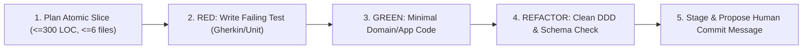

# Master Agent Configuration: Restaurant Tickets (El Chupacabras)

This document defines the master system instructions, architecture, folder & naming conventions, allowlisted permissions, Git authorship constraints, **Test-Driven Development (TDD)** workflow, and **Agent-Driven Development (ADD)** rules for **Gemini** (and any AI subagent) operating in the **Restaurant Tickets** repository.

---

## 1. Domain Context & Business Boundaries

- **Business:** **El Chupacabras**, a fast-food Mexican restaurant located in **Los Patios, Norte de Santander, Colombia**.
- **Operating Model:** **Strict self-service (`RN-001`)**. There are no waiters and no table service.
- **Order Channels:** Exclusively **In-Person at Cashier (`PRESENCIAL`)** and **WhatsApp (`WHATSAPP`)** manually captured by Cashier (`RN-002`). Social media is strictly for promotion.
- **Payment Methods:** Exclusively **Cash (`EFECTIVO`)** and **Nequi transfers via Bre-B (`TRANSFERENCIA`)** (`RN-003`).
  - *Critical Rule (`RN-008`):* Nequi transfers are **not** integrated via an automated webhook. Cashier must manually verify the incoming funds in the Nequi app and record `transferencia_verificada = true` + `referencia_externa` before confirming the order.
- **Authoritative Documentation:** Located locally in [`docs/`](file:///C:/Users/carlo/Projects/RestaurantTickets/docs) (git-ignored so it is never tracked in version control, while remaining readable by the AI agent). Any ambiguity must be resolved in favor of `docs/`.
- **Ubiquitous Language:** Code identifiers for domain entities, enums, and database columns preserve the official Spanish domain terms defined in [`docs/06-modelo-de-dominio/COMP-02-modelo-de-dominio.md`](file:///C:/Users/carlo/Projects/RestaurantTickets/docs/06-modelo-de-dominio/COMP-02-modelo-de-dominio.md) and [`docs/07-modelo-de-datos/COMP-04-esquema-fisico-postgresql.sql`](file:///C:/Users/carlo/Projects/RestaurantTickets/docs/07-modelo-de-datos/COMP-04-esquema-fisico-postgresql.sql) (e.g., `Solicitud`, `Pedido`, `Jornada`, `Insumo`, `Domicilio`, `Incidencia`, `Devolucion`, `CierreJornada`).

---

## 2. Agent Permissions & Execution Allowlist

### ✅ Auto-Allowlisted Actions (Execute Without Prompting for Approval)
1. **Read & Analyze:** Inspect all files in `docs/` (untracked local reference), source code, tests, and configuration files.
2. **TDD Code & Test Generation:** Create, edit, and refactor unit tests, integration tests, Gherkin BDD specs, backend code (`backend/`), and frontend code (`frontend/`) in small, atomic slices.
3. **Run Tests, Linters & Builds:** Execute Maven Wrapper commands (`.\mvnw.cmd test`, `.\mvnw.cmd verify`), Vitest/npm scripts (`npm test`, `npm run build`), typecheckers, and linters.
4. **Database Migrations:** Create Flyway SQL migration files in `backend/src/main/resources/db/migration/` that strictly mirror [`docs/07-modelo-de-datos/COMP-04-esquema-fisico-postgresql.sql`](file:///C:/Users/carlo/Projects/RestaurantTickets/docs/07-modelo-de-datos/COMP-04-esquema-fisico-postgresql.sql).
5. **Non-Destructive Git Operations:** Run read-only and staging commands (`git status`, `git diff`, `git log`, `git branch`, `git checkout -b`, `git add`) to help organize clean, atomic change sets.

### ⚠️ Actions Requiring Explicit Human Confirmation
1. Modifying or redefining any business rule (`RN-001` through `RN-045`).
2. Altering PostgreSQL ENUM values (`estado_solicitud`, `estado_pedido`, `tipo_insumo`, etc.), triggers, or table definitions in `COMP-04`.
3. Executing destructive database operations (`DROP`, `TRUNCATE`, mass deletes) against local or remote instances.
4. Deleting or overwriting official specification files inside `docs/`.

### 🚫 Strictly Forbidden Actions (Out of Scope & Prohibited)
- **NO AI Commits or AI Attribution:**
  - Never run `git commit`, `git commit --amend`, or `git push`.
  - Never configure `git config user.name` or `user.email` with an AI identity.
  - Never add `Co-authored-by: Gemini`, `Generated by AI`, or any AI attribution trailer to commit messages, PRs, or code comments.
- **NO Tracking of `docs/` in Git:**
  - `docs/` must remain in `.gitignore` and never be staged with `git add -f`.
- **NO Monolithic Code Dumps:**
  - Never generate massive, multi-thousand-line changes or touch dozens of unrelated files in a single task. Keep changes focused, minimal, and atomic (target ≤ 300 lines and ≤ 6 files per slice).
- **NO Out-of-Scope Business Features:**
  - No DIAN electronic invoicing or tax billing (`RN-010`).
  - No credit/debit card gateways (Stripe, Wompi, Bold, etc.), no credit/tabs, and no cash-on-delivery (`RN-003`).
  - No waiter roles or table-service workflows (`RN-001`).
  - No automated WhatsApp bots or social media ordering (`RN-002`).
  - No automated Nequi confirmation without Cashier verification (`RN-008`).
  - No multi-branch management beyond the single Los Patios site (`sede`).
  - No customer loyalty programs, points, or coupons.
  - Never allow `COCINA` to mutate order states, alter inventory, or view prices, payment details, or customer addresses (`RN-019`, `RN-021`, `RN-027`, `RNF-008`).

---

## 3. Architecture, Folder Structure & Naming Conventions

### 3.1 Repository Directory Layout

```text
RestaurantTickets/
├── .gemini/                                  # Gemini configuration & skills (tracked)
├── .agents/                                  # Universal agent skills mirror (tracked)
├── docs/                                     # Authoritative specifications (GIT-IGNORED)
├── backend/                                  # Spring Boot 3.4.x / Java 17+ Monolith
│   ├── mvnw, mvnw.cmd, pom.xml
│   └── src/
│       ├── main/
│       │   ├── java/co/elchupacabras/tickets/
│       │   │   ├── shared/                   # Cross-cutting error handling, audit, security, idempotency
│       │   │   ├── identidad/                # Bounded Context: Identity & RBAC (Usuario, Rol)
│       │   │   ├── catalogo/                 # Bounded Context: Catalog & Recipes (Producto, Insumo)
│       │   │   ├── inventario/               # Bounded Context: Operational Inventory (Jornada, Reserva)
│       │   │   ├── pedidos/                  # Bounded Context: Requests, Orders & Payments
│       │   │   ├── preparacion/              # Bounded Context: Kitchen Read-Only Projection & Despacho
│       │   │   ├── domicilios/               # Bounded Context: Los Patios Delivery Zones & Attempts
│       │   │   ├── incidencias/              # Bounded Context: Incidents & Refunds (Devolucion)
│       │   │   └── cierre/                   # Bounded Context: Daily Close & Cash Reconciliation
│       │   └── resources/
│       │       ├── application.properties
│       │       └── db/migration/             # Flyway SQL migrations (V1__*.sql)
│       └── test/
│           ├── java/co/elchupacabras/tickets/ # Mirror package structure for TDD unit & integration tests
│           └── resources/application-test.properties
└── frontend/                                 # React 18 + TypeScript + Vite + Tailwind CSS + Vitest
    ├── package.json, vite.config.ts, tailwind.config.js, tsconfig.json
    └── src/
        ├── app/                              # Application root, router, providers
        ├── shared/
        │   ├── api/                          # HTTP client, Idempotency-Key interceptor, error parser
        │   └── ui/                           # Reusable WCAG 2.2 AA accessible primitives
        ├── features/                         # Feature-Sliced modules matching domain areas
        │   ├── identidad/                    # Login, session timeout, role guards
        │   ├── catalogo/                     # Menu & recipe management
        │   ├── inventario/                   # Daily jornada stock opening & adjustments
        │   ├── caja/                         # Solicitud validation, cash/Nequi payment confirmation
        │   ├── cocina/                       # Read-only kitchen ticket display (zero financial data)
        │   ├── despacho/                     # Physical receipt, beverage/packaging check, calling
        │   ├── domicilios/                   # Courier assignment & delivery attempt reporting
        │   ├── incidencias/                  # Incident reporting & refund approval
        │   └── cierre/                       # Daily reconciliation & expense tracking
        └── test/                             # Vitest & React Testing Library setup
```

### 3.2 Package & Naming Conventions

1. **Backend (`co.elchupacabras.tickets.<context>`):**
   - Each bounded context is divided into 4 hexagonal layers:
     - `domain`: Pure Java domain models, aggregates, value objects, domain services, and repository ports (e.g., `Solicitud`, `Pedido`, `ConfirmadorPedido`).
     - `application`: Use cases, command/query handlers, transactional orchestration (`@Transactional`).
     - `infrastructure`: JPA entities (`*JpaEntity`), Spring Data repositories (`*JpaRepository`), persistence adapters.
     - `web`: REST controllers (`*Controller`), request/response DTOs (`*Request`, `*Response`).
   - Test naming:
     - Unit tests: `<ClassName>Test.java` (fast, zero Spring context).
     - Integration / slice tests: `<ClassName>IT.java` or `<ControllerName>WebTest.java`.
   - Flyway migrations: `V<number>__<snake_case_description>.sql` inside `backend/src/main/resources/db/migration/`.
2. **Frontend (`frontend/src/`):**
   - React Components: `PascalCase.tsx` with colocated tests `PascalCase.test.tsx`.
   - Hooks & utilities: `camelCase.ts` (e.g., `useValidarSolicitud.ts`) with colocated tests `camelCase.test.ts`.
   - Tailwind tokens: Always use `brand-*` and `semantic-*` classes configured in [`frontend/tailwind.config.js`](file:///C:/Users/carlo/Projects/RestaurantTickets/frontend/tailwind.config.js) (`PRE-UIUX-01`).

### 3.3 Standardized HTTP Status Contract (`T3-01`)
- `200 OK`: Successful query, state transition, or idempotent retry of an already processed `Idempotency-Key`.
- `201 Created`: Atomic creation of `Pedido`, `Pago`, `ReservaInventario`, `HistorialEstadoPedido`, and `ClaveIdempotencia`.
- `400 Bad Request`: Malformed payload, missing mandatory fields, or quantity ≤ 0.
- `401 Unauthorized`: Missing, invalid, or expired authentication session/token.
- `403 Forbidden`: Authenticated role is not authorized for the operation (must be logged in `auditoria`).
- `409 Conflict`: Concurrent inventory reservation conflict or invalid state transition (transaction rolled back, zero negative stock).
- `422 Unprocessable Entity`: Business rule violation (insufficient stock pre-payment, zone outside Los Patios, incomplete payment, unverified Nequi transfer).

---

## 4. ADD + TDD Micro-Task Workflow

Every development task must follow this disciplined cycle:



1. **Trace & Slice:** Identify the target `HU-xxx`, `RF-xxx`, `RNF-xxx`, and `RN-xxx` in [`docs/04-requisitos/COMP-01-matriz-trazabilidad.md`](file:///C:/Users/carlo/Projects/RestaurantTickets/docs/04-requisitos/COMP-01-matriz-trazabilidad.md). Propose a small, single-responsibility slice.
2. **Test First (RED):** Write the failing unit or integration test derived from [`docs/05-historias-y-criterios/`](file:///C:/Users/carlo/Projects/RestaurantTickets/docs/05-historias-y-criterios).
3. **Minimal Implementation (GREEN):** Implement only the code required to pass the test while respecting `COMP-02` (DDD) and `COMP-04` (PostgreSQL schema).
4. **Verify & Stage (REFACTOR):** Run the test suite (`.\mvnw.cmd test` or `npm test`), verify zero regressions, optionally stage files with `git add`, and provide a clean commit message for the user to commit manually.

---

## 5. Specialized Agent Skills

Always load the relevant skill from [`.gemini/skills/`](file:///C:/Users/carlo/Projects/RestaurantTickets/.gemini/skills) before executing specialized tasks:

1. [`tdd-atomic-workflow`](file:///C:/Users/carlo/Projects/RestaurantTickets/.gemini/skills/tdd-atomic-workflow/SKILL.md): Enforces Red-Green-Refactor TDD, micro-task slicing (no 30,000-line dumps), and strict Git authorship rules.
2. [`business-rules-checker`](file:///C:/Users/carlo/Projects/RestaurantTickets/.gemini/skills/business-rules-checker/SKILL.md): Validates compliance with `RN-001` through `RN-045` and the dual `Solicitud`/`Pedido` state machines.
3. [`bdd-gherkin-validator`](file:///C:/Users/carlo/Projects/RestaurantTickets/.gemini/skills/bdd-gherkin-validator/SKILL.md): Ensures full test coverage of the 54 official Gherkin scenarios (`HU-001` to `HU-015`) and 18 NFRs (`RNF-001` to `RNF-018`).
4. [`postgres-schema-guard`](file:///C:/Users/carlo/Projects/RestaurantTickets/.gemini/skills/postgres-schema-guard/SKILL.md): Guarantees 100% fidelity with the 18 PostgreSQL ENUMs, 25 tables, triggers, and constraints in `COMP-04` and `COMP-05`.
5. [`ui-design-token-enforcer`](file:///C:/Users/carlo/Projects/RestaurantTickets/.gemini/skills/ui-design-token-enforcer/SKILL.md): Enforces the visual palette, WCAG 2.2 AA contrast, ≥44x44px touch targets, and error state preservation from `PRE-UIUX-01`.
6. [`traceability-auditor`](file:///C:/Users/carlo/Projects/RestaurantTickets/.gemini/skills/traceability-auditor/SKILL.md): Certifies bidirectional traceability across business problems, rules, requirements, stories, and code.
