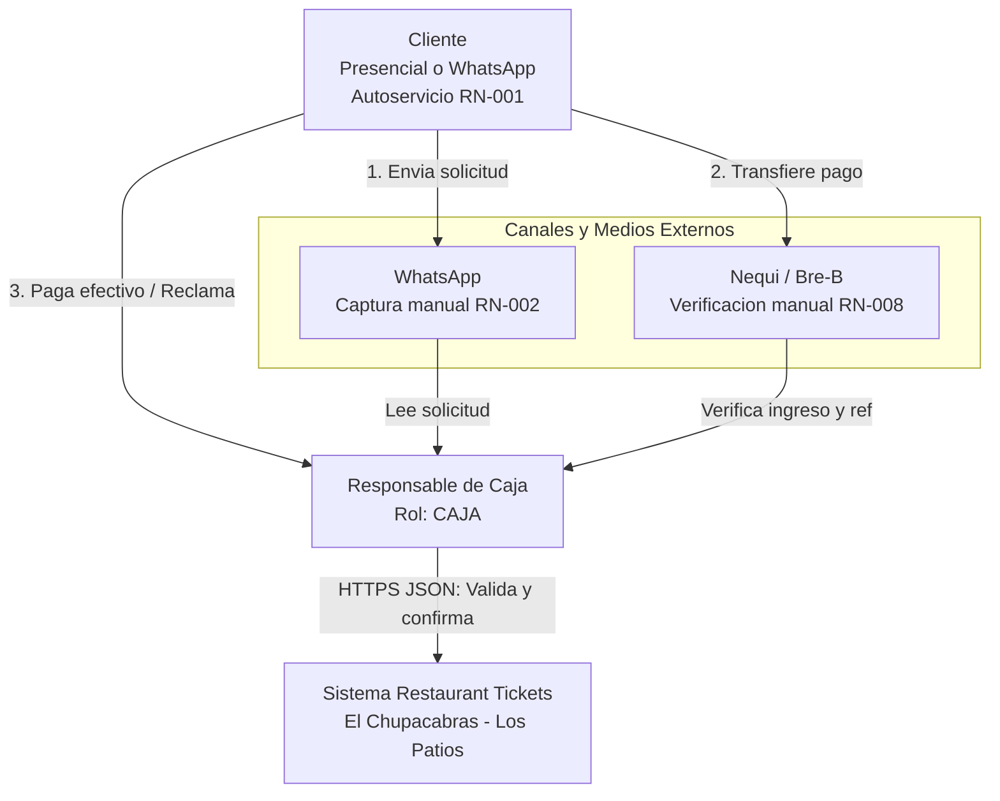
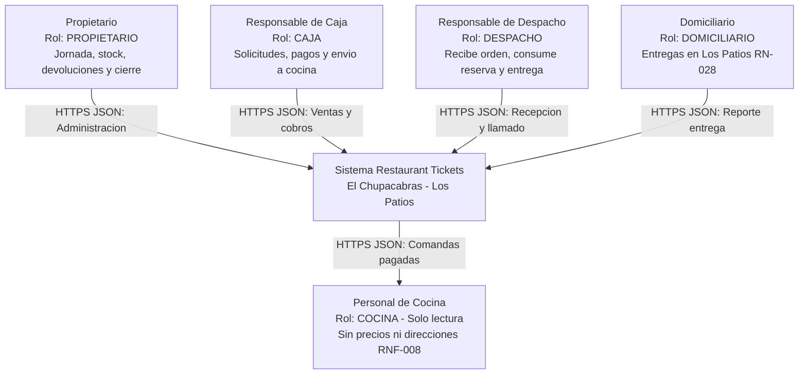
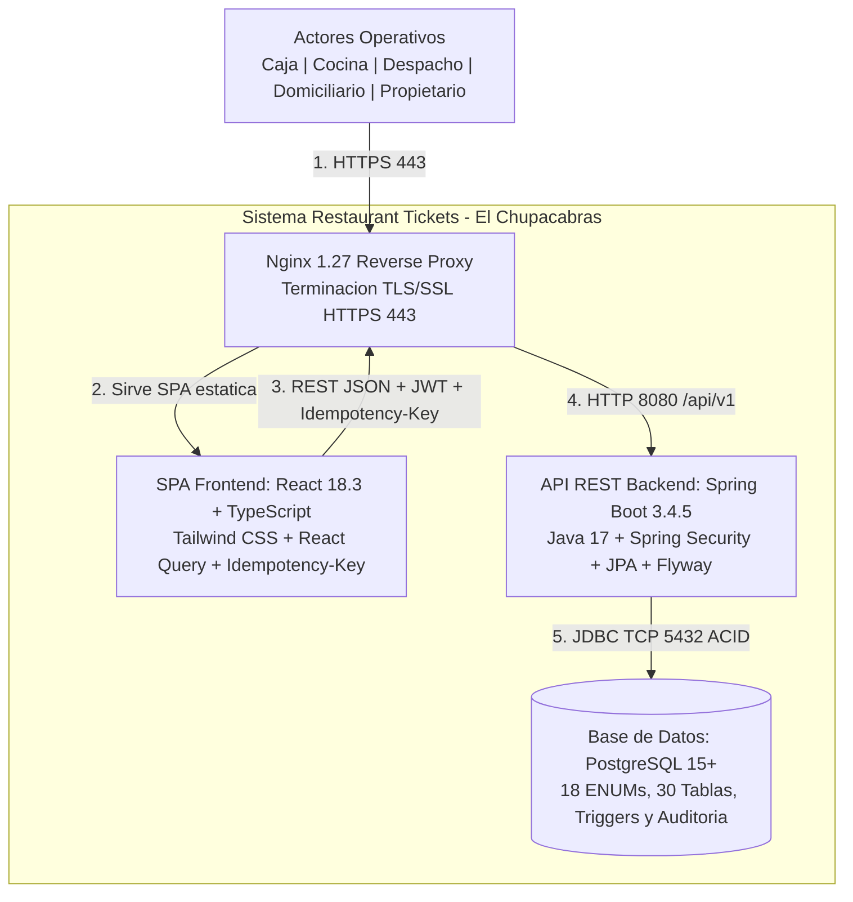
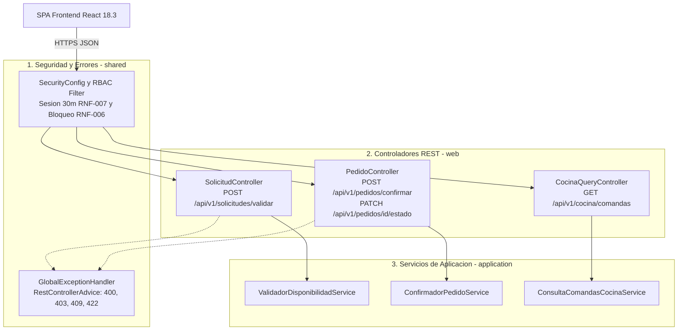
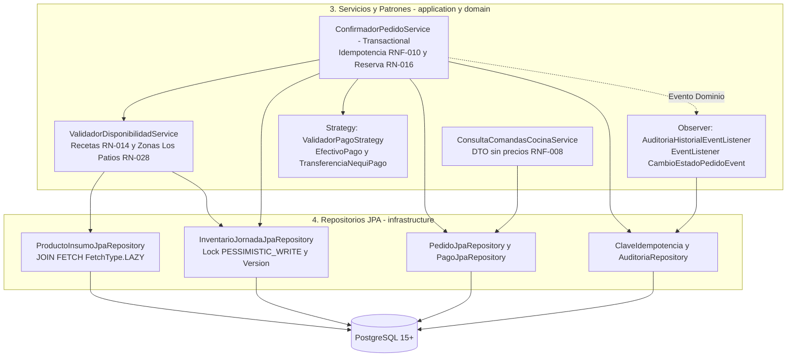

# 1. Vista Arquitectónica y Modelo C4 (Diagrams as Code)

## 1.1 Justificación del Estilo Arquitectónico

Para el sistema **Restaurant Tickets ("El Chupacabras")** se adoptó una arquitectura de **Monolito Modular con Arquitectura Hexagonal (Ports & Adapters / Clean Architecture) y Domain-Driven Design (DDD)** sobre un único artefacto desplegable en **Spring Boot 3.4.5 / Java 17+** y **PostgreSQL 15+**, organizado internamente en **8 Contextos Delimitados (Bounded Contexts)** (`identidad`, `catalogo`, `inventario`, `pedidos`, `preparacion`, `domicilios`, `incidencias`, `cierre`) y un módulo transversal (`shared`).

Cada contexto delimitado separa estrictamente sus responsabilidades en cuatro capas:
1. **`domain` (Núcleo de Dominio):** Entidades de negocio puras, Agregados (`Solicitud`, `Pedido`, `Jornada`, `InventarioJornada`, `Devolucion`), Objetos de Valor, las 18 Enumeraciones del negocio (`EstadoPedido`, `EstadoSolicitud`, `MedioPago`, `TipoInsumo`, etc.) y Estrategias de dominio sin acoplamiento a frameworks web o detalles de infraestructura.
2. **`application` (Casos de Uso y Orquestación Transaccional):** Servicios de aplicación (`@Service`, `@Transactional`), coordinación entre módulos y publicación/escucha de eventos internos de dominio (`ApplicationEventPublisher` / `@EventListener`).
3. **`infrastructure` (Adaptadores Secundarios / Persistencia):** Entidades ORM (`@Entity`), repositorios Spring Data JPA (`JpaRepository`) con bloqueo pesimista (`LockModeType.PESSIMISTIC_WRITE`) y optimista (`@Version`), configuración de seguridad RBAC y migraciones versionadas con Flyway hacia PostgreSQL 15+.
4. **`web` (Adaptadores Primarios / API REST):** Controladores REST (`@RestController`), DTOs de entrada/salida con validaciones Jakarta Bean Validation (`@Valid`) y manejo centralizado de errores (`@RestControllerAdvice`).

| Atributo de Calidad (RNF) | Escenario y Métrica Cuantificable Exigida | Respuesta Arquitectónica del Monolito Modular Hexagonal |
|---|---|---|
| **Integridad y Concurrencia (`RNF-004`, `RNF-010`)** | 0 inventarios negativos y 0 reservas dobles en 1.000 confirmaciones concurrentes (`409 Conflict` <= 2 s); 0 pedidos duplicados en 1.000 reintentos con `Idempotency-Key` (`200 OK` <= 2 s). | Al residir `pedidos` e `inventario` en el mismo proceso y base de datos PostgreSQL 15+, la confirmación de pago (`POST /api/v1/pedidos/confirmar`) se ejecuta en una **única transacción ACID local (`@Transactional`)** combinando bloqueo selectivo de filas (`SELECT ... FOR UPDATE` / `LockModeType.PESSIMISTIC_WRITE`), control optimista (`@Version`) y verificación en la tabla `clave_idempotencia`, evitando la complejidad y latencia de transacciones distribuidas (2PC/Sagas). |
| **Rendimiento (`RNF-001`, `RNF-002`, `RNF-003`)** | Consulta de catálogo/disponibilidad P95 <= 1 s; validación de receta (hasta 30 ítems y 200 insumos) P95 <= 800 ms; transición de estado en despacho P95 <= 1 s. | Comunicación en memoria (in-process) entre módulos del monolito sin saltos de red RPC entre microservicios; carga perezosa (`FetchType.LAZY`) en todas las relaciones JPA; consultas proyectadas con `JOIN FETCH` e índices compuestos en PostgreSQL 15+ y caché de corta duración en React Query. |
| **Seguridad y Privacidad (`RNF-005`, `RNF-006`, `RNF-007`, `RNF-008`)** | 100 % de intentos no autorizados rechazados con `403 Forbidden` y auditados; bloqueo de cuenta 15 min tras 5 fallos (`RNF-006`); expiración de sesión a los 30 min (`RNF-007`); **0 campos financieros o de dirección expuestos a Cocina (`RNF-008`)**. | Filtro de seguridad centralizado con RBAC por rol (`PROPIETARIO`, `CAJA`, `COCINA`, `DESPACHO`, `DOMICILIARIO`). El módulo `preparacion` expone un **DTO de proyección exclusivo para Cocina (`ComandaCocinaResponse`)** construido en el servidor que omite precios, pagos, referencias Nequi y direcciones. |
| **Mantenibilidad y Evolución (`RNF-014`, `RNF-015`)** | Cambios en tarifas de zona o reglas de transición aislados en máximo 2 módulos, 0 dependencias circulares y 100 % de compatibilidad con pedidos históricos. | La Arquitectura Hexagonal aísla las reglas (`RN-001` a `RN-045`) en el paquete `domain` y aplica los patrones **Strategy** (verificación de pagos Efectivo vs. Nequi) y **Observer** (auditoría e historial de estados). Las instantáneas comerciales (`producto_nombre`, `precio_unitario`, `zona_nombre_snapshot`) garantizan inmutabilidad histórica. |
| **Disponibilidad Local y Recuperación (`RNF-009`, `RNF-011`, `RNF-013`)** | 100 % de continuidad en ventas presenciales en efectivo ante caída de Internet externo; `RPO = 0` y `RTO <= 10 min`; consumo RAM backend <= 512 MB. | El despliegue de un monolito autocontenido (`-Xmx512m`) junto a PostgreSQL 15+ en red local o VPS único permite operar sin depender de pasarelas de pago externas en la nube. |

---

## 1.2 Nivel 1 — Diagrama de Contexto del Sistema (C4 Level 1)

### 1.2.1 Vista de Interacción con Clientes, Caja y Sistemas Externos

### 1.2.2 Vista de Roles Operativos Internos y el Sistema Central

---

## 1.3 Nivel 2 — Diagrama de Contenedores (C4 Level 2)

---

## 1.4 Nivel 3 — Diagrama de Componentes del Backend (C4 Level 3)

### 1.4.1 Vista de Seguridad, Manejo de Errores y Controladores Web

### 1.4.2 Vista de Servicios de Aplicación, Patrones de Dominio y Persistencia JPA

