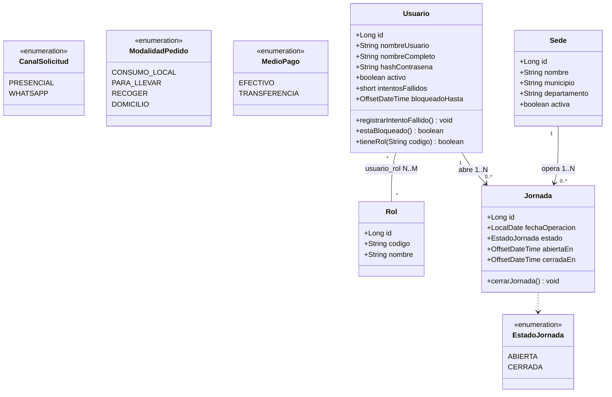
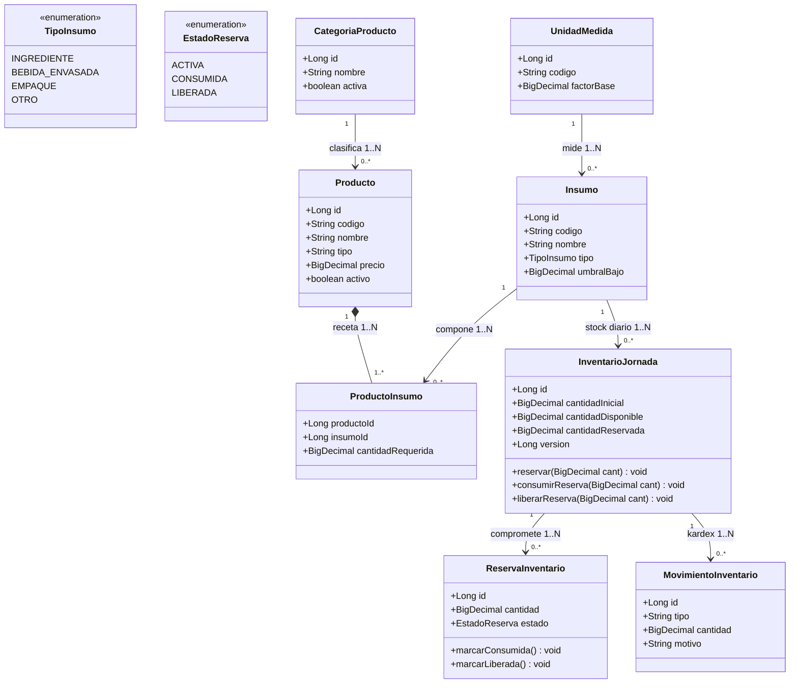
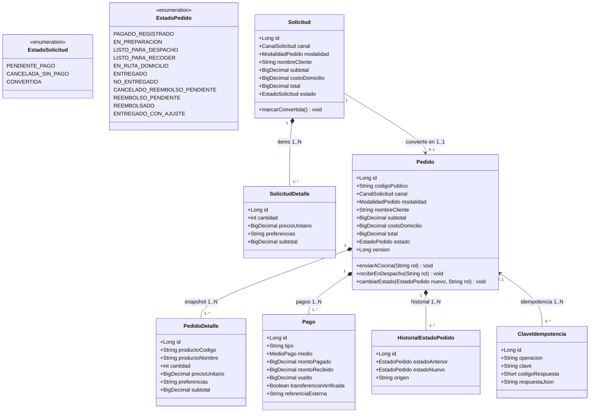
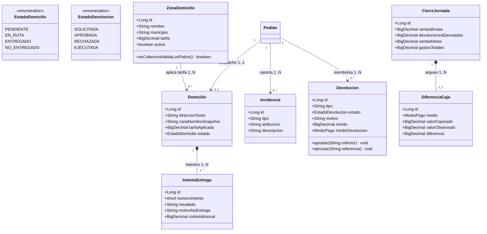
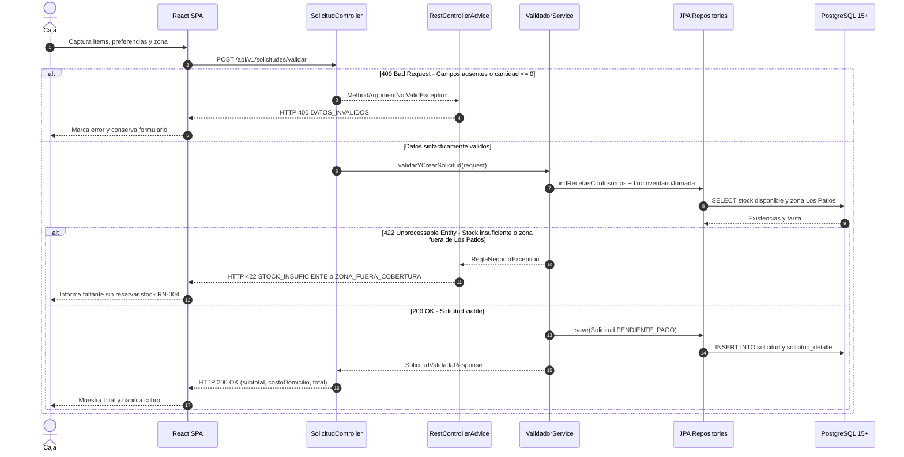
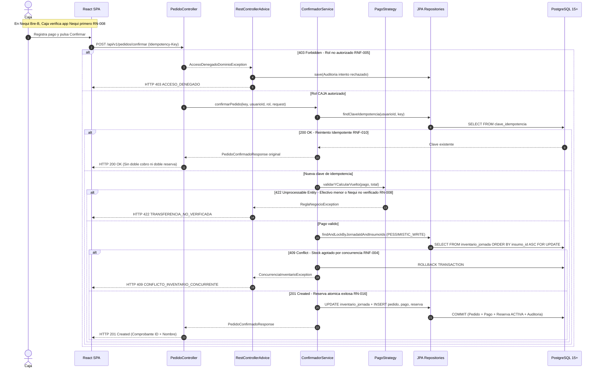
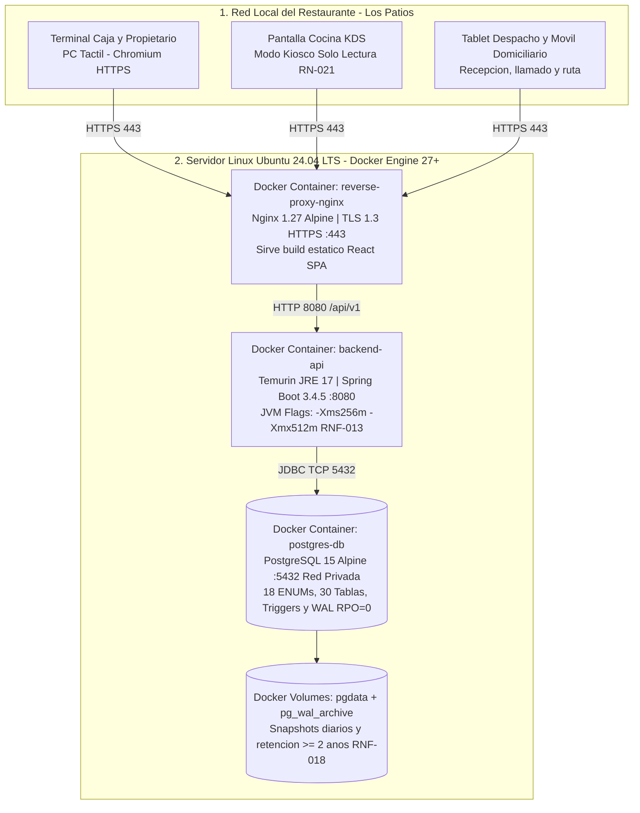

# 2. Modelado UML Esencial para Producción

## 2.1 Diagrama de Clases de Dominio (UML Class Diagram)

Para garantizar total legibilidad, el modelo de clases de dominio se organiza en cuatro vistas modulares cohesivas que cubren la totalidad de entidades, atributos tipados, métodos, enumeraciones y cardinalidades (`1:1`, `1:N`, `N:M`).

### 2.1.1 Subsistema de Identidad, Sede, Jornada y Enumeraciones Principales

### 2.1.2 Subsistema de Catálogo, Recetas e Inventario Operativo por Jornada

### 2.1.3 Subsistema Nuclear de Solicitudes, Pedidos, Pagos e Idempotencia

### 2.1.4 Subsistema de Domicilios en Los Patios, Incidencias, Devoluciones y Cierre

---

## 2.2 Diagrama de Secuencia Full Stack (Flujo Transaccional Crítico)

### 2.2.1 Fase 1: Captura y Validación Previa de Solicitud (Sin Reserva de Stock — `RN-004`, `RN-015`, `RN-028`)

### 2.2.2 Fase 2: Verificación de Pago, Idempotencia y Reserva Atómica de Inventario (`RN-008`, `RN-016`, `RNF-004`, `RNF-010`)

---

## 2.3 Diagrama de Despliegue (UML Deployment Diagram)

